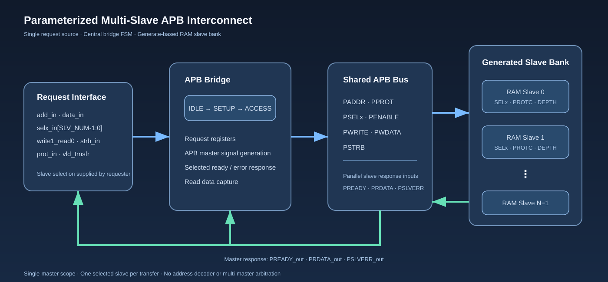

# Parameterized Multi-Slave APB Interconnect

A scalable, parameterized APB interconnect implemented in SystemVerilog. The design connects a request-side master interface to a configurable set of APB slave endpoints through a centralized bridge, shared APB control/data signals, and per-slave response logic.

The implementation combines a three-state APB transaction controller, independently configurable memory-mapped slaves, byte-write strobes, per-slave protection checking, address-range checking, and response aggregation back to the requester.

> **Project ownership:** The RTL architecture and functional design were developed from scratch by the project author. AI assistance was used only after the RTL design was complete for source formatting and comment refinement. The verification plan and scenarios were defined by the author; AI assistance was used as a syntax and testbench-polishing aid, not to originate the design or verification strategy.

Developed in collaboration with [Mohamed Khaled](https://www.linkedin.com/in/mohamed-khaled-77b685317/).

## Highlights

- Parameterized data width, address width, slave count, and byte-strobe width.
- Generate-based instantiation of multiple independently configured APB RAM slaves.
- Centralized bridge with `IDLE`, `SETUP`, and `ACCESS` states.
- APB request capture and registered transfer fields.
- Independent slave-select, protection, and memory-depth configuration.
- Byte-level write enables through `PSTRB`.
- Address-out-of-range and protection-mismatch error responses.
- Selected-slave response aggregation for `PREADY`, `PRDATA`, and `PSLVERR`.
- Back-to-back request support when the current access completes and the next request is valid.
- Self-checking directed, negative, boundary, back-to-back, and randomized smoke tests.
- Vivado place-and-route implementation with a 100 MHz timing target and positive reported setup/hold slack.

## Architecture



The design is organized into four functional parts:

1. **Request interface** - accepts the address, write data, selected-slave vector, transfer direction, byte strobes, protection attribute, and request-valid indication.
2. **APB bridge** - captures a request and sequences the APB `SETUP` and `ACCESS` phases. It drives the shared APB address, protection, select, enable, write, data, and strobe signals.
3. **Slave bank** - instantiates `SLV_NUM` APB RAM endpoints. Each endpoint has its own select ID, expected protection value, and memory depth.
4. **Response path** - combines the selected slaves' ready/error responses and captures read data from the responding selected slave.

The request interface supplies `selx_in`; the bridge distributes this selection to `PSELx`. The current RTL therefore expects the requester to present a valid one-hot slave selection for a single-slave transfer. It is a single-master bridge; multi-master arbitration and address-to-slave decoding are outside the current design boundary.

See [Architecture and Protocol](docs/architecture.md) for the detailed block responsibilities, state transitions, interface signals, and configuration model.

## Parameterization

| Parameter | Default in top/bridge | Purpose |
|---|---:|---|
| `DATA_WIDTH` | 32 | APB write/read data width |
| `ADDR_WIDTH` | 8 | APB address width at the top level |
| `SLV_NUM` | 4 | Number of generated slave endpoints |
| `STRB_SIZE` | `DATA_WIDTH/8` | Number of byte strobes |

Each slave instance is configured with:

- `SELx` - its `PSELx` encoding.
- `PROTC` - the protection value accepted by that slave.
- `DEPTH` - number of addressable words in its local memory.

The RAM module defaults to a depth of 32 words. The top-level module passes the common data/address/strobe parameters and the per-slave configuration array values into each generated slave.

### Configuration used by the supplied testbench

| Parameter | Test configuration |
|---|---:|
| `DATA_WIDTH` | 32 |
| `ADDR_WIDTH` | 8 |
| `SLV_NUM` | 2 |
| `STRB_SIZE` | 4 bytes |
| Slave 0 select | `2'b01` |
| Slave 1 select | `2'b10` |
| Slave 0 protection | `3'b101` |
| Slave 1 protection | `3'b010` |
| Memory depth per slave | 32 words |

The design is parameterized for a variable number of slaves. The supplied self-checking regression demonstrates the two-slave configuration shown above; configurations beyond that should be elaborated and verified with matching per-slave parameter arrays and a corresponding testbench configuration.

## APB transaction flow


- **IDLE:** Waits for `vld_trnsfr`. When asserted, request fields are captured and the bridge advances to `SETUP`.
- **SETUP:** Asserts the selected `PSELx` while keeping `PENABLE` low. The next state is `ACCESS`.
- **ACCESS:** Asserts `PENABLE` and holds the selected request while waiting for a selected slave to assert `PREADY`. If another request is valid when the current access completes, the FSM returns to `SETUP`; otherwise it returns to `IDLE`.

The APB RAM endpoint checks the selected-slave ID, protection attribute, and address range. Legal reads return the addressed word. Legal writes update only the byte lanes enabled by `PSTRB`. Illegal protection or out-of-range accesses raise `PSLVERR` and complete with `PREADY` asserted.

## Error handling and data integrity

| Condition | Slave behavior | Response visible to master |
|---|---|---|
| Valid read | Drives the addressed memory word | `PREADY=1`, read data captured, `PSLVERR=0` |
| Valid write | Updates selected byte lanes | `PREADY=1`, `PSLVERR=0` |
| Protection mismatch | Rejects access | `PREADY=1`, `PSLVERR=1` |
| Address outside `DEPTH` | Rejects access | `PREADY=1`, `PSLVERR=1` |
| No selected ready slave | Waits for completion | `PREADY=0` |

The bridge qualifies `PREADY` and `PSLVERR` with `PSELx` and captures read data from the selected ready slave on a successful read. The current interface assumes a single selected slave per request; multi-hot selection is not a supported arbitration mode.

## Functional verification

The supplied SystemVerilog testbench includes:

- Reset and basic write/read transactions for both configured slaves.
- Full-word and partial-byte writes using `PSTRB`.
- First and last legal addresses in each slave memory.
- Out-of-range address tests.
- Protection-mismatch tests for writes and reads.
- Back-to-back transfers.
- A randomized smoke sequence with 50 write/read iterations.
- Timeout protection for stalled transactions.
- Self-checking comparisons and pass/fail counters.

**186 PASS · 0 FAIL**

The final simulator transcript shown in the project evidence reports **186 checks, 186 passes, and 0 failures**. The testbench output reports a simulation time of 1,247 ns. Detailed test scope and result notes are in [Verification Results](docs/verification.md).

## Vivado implementation and timing

The project was synthesized and implemented in Vivado, including placement and routing, with a 100 MHz timing target. The supplied Vivado Design Timing Summary screenshot reports:

| Timing metric | Reported result |
|---|---:|
| Worst Negative Slack (WNS) | **+7.086 ns** |
| Total Negative Slack (TNS) | 0.000 ns |
| Setup failing endpoints | 0 |
| Setup endpoints analyzed | 4,345 |
| Worst Hold Slack (WHS) | **+0.056 ns** |
| Total Hold Slack (THS) | 0.000 ns |
| Hold failing endpoints | 0 |
| Hold endpoints analyzed | 4,345 |
| Worst Pulse Width Slack (WPWS) | **+4.650 ns** |
| Total Pulse Width Negative Slack (TPWS) | 0.000 ns |
| Pulse-width failing endpoints | 0 |
| Pulse-width endpoints analyzed | 2,202 |

The summary states that all user-specified timing constraints are met. The 100 MHz value is the implementation target; the positive WNS is the reported timing margin against that constraint. These are Vivado report results, not a measured board-throughput result.

The original Vivado utilization report, XDC constraints, and project TCL were not available in the files used to prepare this repository. For that reason, no LUT/FF/BRAM utilization numbers or reproducible Vivado command sequence are claimed here. See [Vivado Results and Evidence](docs/vivado_results.md).

## Repository layout

```text
.
├── rtl/
│   ├── apb_bridge.sv
│   ├── apb_RAM_one.sv
│   └── apb_top.sv
├── tb/
│   └── apb_top_testbench.sv
└── docs/
    ├── architecture.md
    ├── verification.md
    ├── vivado_results.md
    ├── development_notes.md
    └── assets/
        ├── apb_interconnect_architecture.svg
        └── apb_bridge_fsm.svg
```

## Tools and language

- SystemVerilog RTL
- SystemVerilog self-checking testbench
- AMD/Xilinx Vivado synthesis and implementation flow

## Scope

This repository documents the current single-master, parameterized multi-slave APB bridge and the memory-mapped RAM endpoints included in the RTL. It does not claim multi-master arbitration, automatic address decoding, formal verification, ASIC physical design, or hardware throughput measurements.

## Collaboration and development approach

The project was developed in collaboration with Mohamed Khaled. The author defined and implemented the RTL architecture and functional design. AI assistance was limited to post-implementation formatting/comment refinement and syntax-level testbench polishing based on the author's verification plan.
